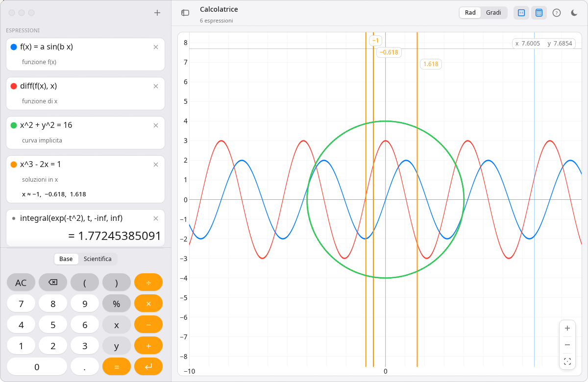

# Calcolatrice

Calcolatrice scientifica per il desktop, scritta in Rust con [egui](https://github.com/emilk/egui).
Accetta formule scritte come su carta, le calcola mentre scrivi e **disegna automaticamente il grafico
delle variabili che non hai definito**. L'interfaccia imita lo stile di macOS.



## Funzionalità

- **Formule naturali**: `2x`, `3(x+1)`, `sin x`, `x²`, `√2`, `|x|`, `5!`, `π`, `100 - 10%`.
- **Definizioni** di costanti e funzioni: `a = 3`, `f(x) = x² + a`, poi `f(2)`.
- **Analisi**: derivate `diff(f(x), x)`, integrali `integral(exp(-t^2), t, -inf, inf)`,
  sommatorie `sum(1/k^2, k, 1, 100)` e produttorie `prod(…)`, funzioni a tratti `if(x < 0, -x, x)`.
- **Grafici automatici** in base alle variabili libere:

  | Scrivi                         | Ottieni                                        |
  |--------------------------------|------------------------------------------------|
  | `sin(x)`, `y = x²`, `x = y²`   | curva                                          |
  | `x² + y² = 16`                 | curva implicita                                |
  | `sin(x) cos(y)`                | mappa di colore di f(x, y)                     |
  | `(cos t, sin 2t)`              | curva parametrica                              |
  | `r = 1 + cos θ`                | curva polare                                   |
  | `x³ − 2x = 1`                  | soluzioni numeriche nell'area visibile         |
  | `a sin(k x)`                   | `a` e `k` diventano slider, animabili con ▶    |

- **Tastierino** base o scientifico (con `2nd` per le funzioni inverse), modalità radianti/gradi.
- **Pannello del grafico opzionale**: nascondendolo resta la sola calcolatrice, anche in una finestra stretta.
- Tema chiaro e scuro (automatico o manuale); lo stato viene salvato alla chiusura.

## Installazione

### Arch Linux

Il PKGBUILD si trova in [`packaging/arch`](packaging/arch/PKGBUILD) e scarica la versione rilasciata da GitHub:

```sh
git clone https://github.com/francescoalemanno/calcolatrice.git
cd calcolatrice/packaging/arch
makepkg -si
```

`makepkg` installa le dipendenze di compilazione (`cargo`), compila, esegue i test e installa il pacchetto
`calcolatrice` con `pacman`. Dopo l'installazione la trovi nel menu delle applicazioni come
**Calcolatrice**, oppure la avvii da terminale con:

```sh
calcolatrice
```

Per disinstallarla:

```sh
sudo pacman -R calcolatrice
```

### Altre distribuzioni Linux, macOS e Windows (con Cargo)

Serve Rust 1.85 o successivo ([rustup.rs](https://rustup.rs)). Poi:

```sh
cargo install --locked --git https://github.com/francescoalemanno/calcolatrice
```

L'eseguibile viene installato in `~/.cargo/bin/calcolatrice`. Su Linux servono a runtime le librerie
grafiche già presenti in qualunque desktop (OpenGL, `libxkbcommon`, X11 o Wayland).

Per avere anche la voce nel menu delle applicazioni su Linux:

```sh
git clone https://github.com/francescoalemanno/calcolatrice.git
cd calcolatrice
install -Dm644 assets/calcolatrice.desktop -t ~/.local/share/applications
install -Dm644 assets/calcolatrice.svg -t ~/.local/share/icons/hicolor/scalable/apps
for s in 16 24 32 48 64 128 256 512; do
  install -Dm644 assets/icons/${s}x${s}/calcolatrice.png -t ~/.local/share/icons/hicolor/${s}x${s}/apps
done
```

### Dal sorgente

```sh
git clone https://github.com/francescoalemanno/calcolatrice.git
cd calcolatrice
cargo run --release
```

## Uso

| Tasto / azione                       | Effetto                                     |
|--------------------------------------|---------------------------------------------|
| `Invio`                              | nuova riga                                  |
| `↑` / `↓`                            | riga precedente / successiva                |
| `⌫` su una riga vuota                | elimina la riga                             |
| clic sul pallino colorato            | mostra/nasconde il grafico                  |
| clic destro sul pallino              | cambia colore                               |
| clic su un risultato                 | copia il valore                             |
| doppio clic sul grafico              | ripristina la vista                         |
| “asse: … ⇄”                          | sceglie la variabile in ascissa             |

Il riquadro **?** nella barra in alto elenca tutte le funzioni disponibili.

**Font**: l'interfaccia usa SF Pro o Inter se installati, altrimenti Noto Sans
(`noto-fonts` su Arch), altrimenti il carattere integrato di egui.

**Icona non visibile nel menu dopo l'installazione?** Su Cinnamon premi `Ctrl+Alt+Esc`
(riavvia la shell senza chiudere le finestre); su altri desktop basta uscire e rientrare.

**Dati salvati**: espressioni e impostazioni sono in `~/.local/share/calcolatrice/app.ron`.

**Nota**: la finestra usa angoli arrotondati trasparenti; senza un compositor
(es. su un window manager X11 minimale) negli angoli compare un piccolo bordo nero.

## Sviluppo

```sh
cargo test        # test del parser e del motore numerico
cargo clippy
```

Struttura del codice in `src/`:

- `parser.rs`: lexer e parser a discesa ricorsiva
- `eval.rs`: compilazione ed esecuzione delle espressioni, funzioni numeriche (integrali tanh-sinh, Γ, erf)
- `analysis.rs`: decide cosa rappresenta ogni riga e quale grafico disegnare
- `plotting.rs`: campionamento delle curve, radici, curve implicite (marching squares), mappe di colore
- `theme.rs`: palette, caratteri e widget in stile macOS
- `app.rs`: interfaccia

### Pubblicare una nuova versione

1. Aggiorna `version` in `Cargo.toml` e `pkgver` in `packaging/arch/PKGBUILD` (rimetti `pkgrel=1`).
2. Crea e pubblica il tag: `git tag v<versione> && git push origin v<versione>`.
3. Aggiorna checksum e `.SRCINFO`:
   ```sh
   cd packaging/arch
   updpkgsums
   makepkg --printsrcinfo > .SRCINFO
   ```

## Licenza

[MIT](LICENSE)
